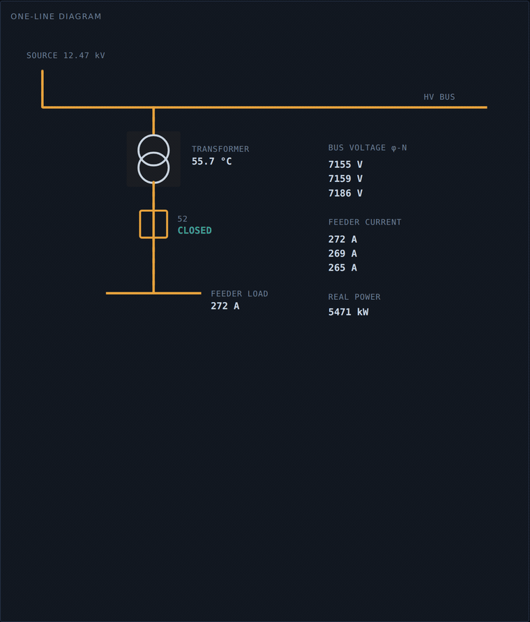

# ICS Grid Substation — Digital Twin & Fleet Lab

A working digital twin of a **12.47 kV distribution substation feeder**, driven
by a fleet of ESP32 field devices publishing coupled, physically-coherent
telemetry over MQTT. Built as OT/ICS security research — and as a portfolio
piece where **judgment and restraint are the point**, not raw capability.

> **See it in 30 seconds, no hardware:** open [`twin/grid_twin.html`](twin/grid_twin.html)
> in a browser. It runs a built-in simulator that is a line-for-line port of the
> real firmware. Trip the breaker and watch current collapse while **bus voltage
> holds** — the Industroyer signature.
>
> Have the fleet running? Same file: **Connect to fleet…** switches it to live
> MQTT telemetry, read-only.



## What this is

Six ESP32 boards run one universal firmware binary, each simulating an OT field
device. Identity is derived from the chip MAC; role lives in NVS; updates go out
over the air. The grid role is the fully-realized reference: eleven telemetry
tags, all riding a single slow-moving load factor so the data is coherent rather
than independent noise. Telemetry flows MQTT → InfluxDB → Grafana, and into a
self-contained digital twin.

The central attack surface is `breaker_status`. Opening it reproduces the
**Industroyer / 2016 Ukraine** signature: feeder current and real power collapse
while bus voltage holds steady. Not a blackout — a *commanded trip*, which is a
different and detectable thing.

## Why it's built the way it is

This repo leads with constraints, because that's the signal for an OT audience:

- **Firmware is ground truth.** The reference docs had drifted; the flashed code
  won. Six documented corrections in [ADR-0002](docs/adr/0002-firmware-is-ground-truth.md).
- **A silent-failure class, caught before release.** A pre-existing fleet manager
  spoke an older command scheme; shipping it would have failed silently on every
  command. [ADR-0003](docs/adr/0003-command-topic-scheme.md).
- **An invariant violation, documented openly.** IPv6 global-unicast addresses
  bypass the planned VLAN boundary. Status: **Open**, foregrounded, not buried.
  [ADR-0004](docs/adr/0004-ipv6-exposure.md).
- **Detection over offense.** V1 ships the visualization and detection side; the
  attack is described and simulated, never weaponized. [ADR-0007](docs/adr/0007-attack-tooling-scope.md).

Start with [`docs/SAFETY.md`](docs/SAFETY.md) — the invariant → mechanism →
evidence table — if you're reviewing this. For framework framing (IEC 62443
zones/conduits with honest SL-T vs SL-A, NIST SP 800-82r3 control mapping, Zero
Trust, UNS), see [`docs/frameworks/`](docs/frameworks/).

## Repository layout

```
ics-grid-twin/
├── README.md              this file
├── LICENSE                MIT
├── SAFETY.md → docs/SAFETY.md
├── docs/
│   ├── SAFETY.md          invariant → mechanism → evidence (read this first)
│   ├── architecture.md    Purdue placement + data/command paths (mermaid)
│   ├── quickstart.md      clone → run, with and without hardware
│   ├── data-pipeline.md   broker + historian bring-up
│   ├── hardware-bom.md    parts list
│   ├── frameworks/        IEC 62443, NIST SP 800-82r3, Zero Trust, UNS
│   └── adr/               architecture decision records (the reasoning)
├── firmware/universal_field/   the validated ESP32 firmware + secrets template
├── infra/                 docker-compose: mosquitto, influxdb, grafana, bridge
│   ├── mosquitto/config/  broker config + default-deny ACL
│   ├── mqtt-bridge/       MQTT → InfluxDB bridge (board_id/device tagging)
│   └── grafana/dashboards/ importable fleet dashboard JSON
├── fleet-manager/         tkinter supervisory console (read-only by default)
├── scripts/mock_fleet.py  six-feeder fleet simulator — NO HARDWARE NEEDED
├── tools/capture_demo.py  scripted, seeded GIF capture of the demo
└── twin/grid_twin.html    the digital twin — simulator or live MQTT
```

## Quickstart

- **No hardware, just the twin:** open `twin/grid_twin.html`. Done.
- **No hardware, whole pipeline:** `docker compose --profile sim up` in `infra/`
  brings up the broker, historian, and a **six-feeder mock fleet** — the Grafana
  dashboard populates, the fleet manager discovers six feeders and can trip their
  breakers, and the twin connects live. Zero ESP32s required.
- **With the real fleet:** [`docs/quickstart.md`](docs/quickstart.md).

## Roadmap

- **V2:** richer physics twin (proper backend engine, replay/backfill from
  InfluxDB, multi-role), the remaining five role physics models delivered over
  OTA, and water-treatment as the second twin (Oldsmar attack demo).
- **Aspirational (V2+):** the offensive side — Modbus-TCP attack automation from
  Kali — kept in a separate, change-controlled context by design ([ADR-0007](docs/adr/0007-attack-tooling-scope.md)).
- **Blocking Loop 4:** VLAN segmentation + IPv6 resolution ([ADR-0004](docs/adr/0004-ipv6-exposure.md)).

## License

MIT — see [LICENSE](LICENSE).
