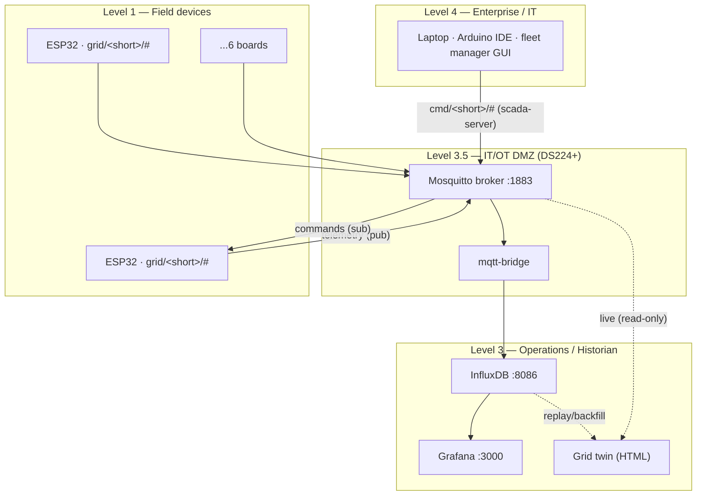

# Architecture

## Purdue-model placement



## Data path

```
ESP32 fleet
   │  MQTT publish, every 2 s, {"value":<float>,"device":"grid-substation-<short>"}
   ▼
Mosquitto broker  203.0.113.163:1883   (default-deny ACL)
   │  monitor-reader subscribes #
   ▼
mqtt-bridge  →  InfluxDB line protocol   (measurement=grid, tags board_id+device)
   ▼
InfluxDB  203.0.113.163:8086   org "ICS Lab" · bucket ics-telemetry
   ▼
Grafana dashboard  ·and·  grid twin (live or replay)
```

## Command path (supervisory)

```
fleet manager (scada-server)  →  cmd/<short>/breaker  "open"|"close"
                                 cmd/<short>/role     "<rolename>"
   broker delivers to board's  cmd/<short>/#  subscription
   → firmware onMessage() acts, re-publishes breaker_status
```

A clean publish proves only that the broker accepted the message. Delivery
depends on the `esp32-field` ACL granting `topic read cmd/#`. See ADR-0003.

## The one signature that matters

Opening a breaker collapses **feeder current and real power** while **bus
voltage holds**. That asymmetry — not a blackout — is the Industroyer / 2016
Ukraine signature, and it is what the twin, the dashboard, and the physics port
are all built to make legible. A model that de-energizes the bus on breaker-open
is showing an event that didn't happen.
